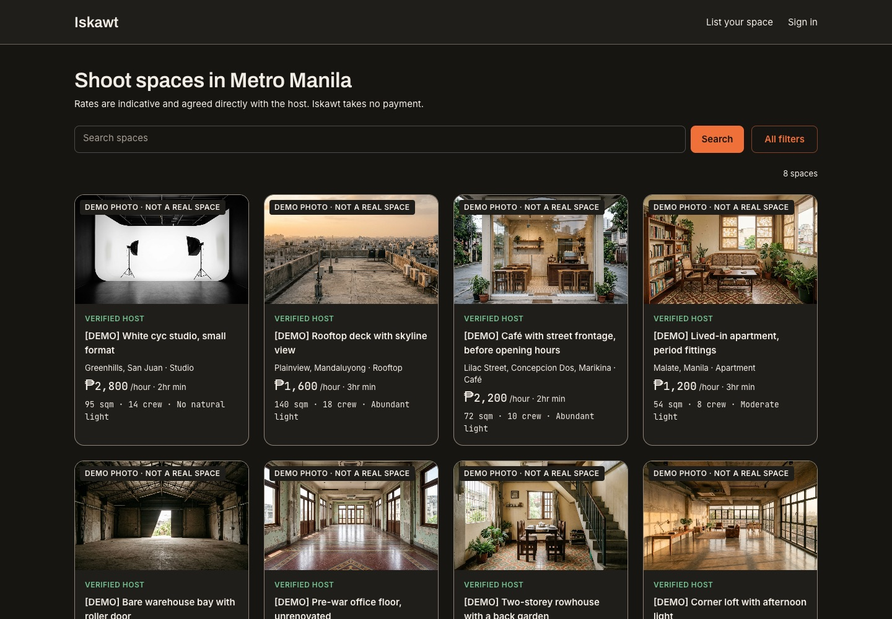
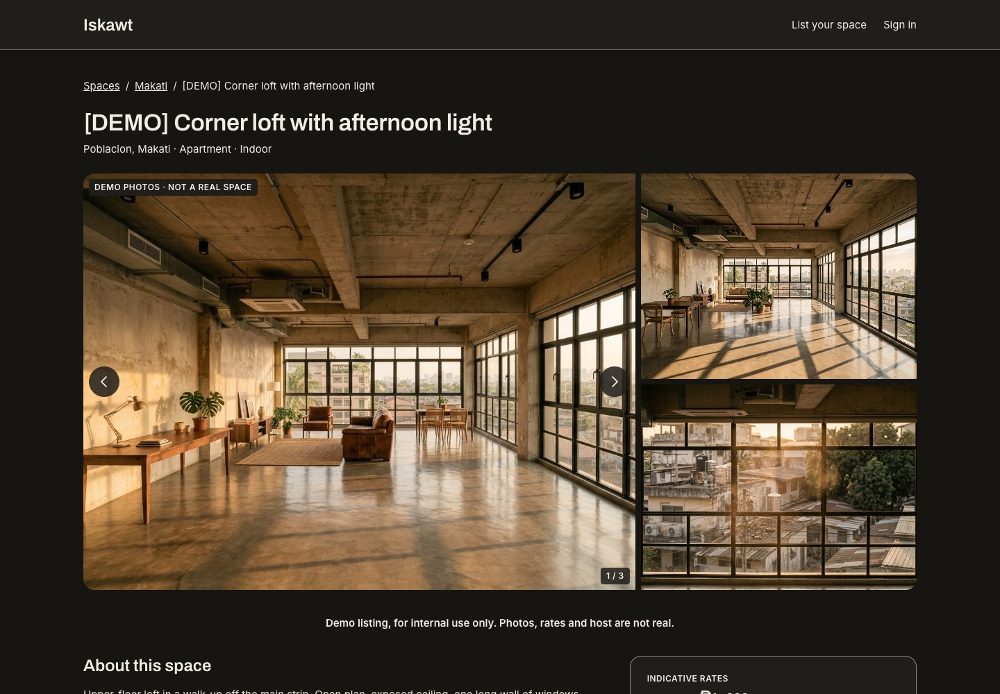

# Iskawt

**Private shoot spaces in Metro Manila.** A listing directory of apartments, studios, rooftops, cafés and warehouses whose owners are open to film and photo shoots. Renters browse and send an inquiry. Host and renter talk in an in-app thread, and arrange the rest themselves.

*Iskawt* is the Filipino respelling of "scout", as in location scouting.

**Live demo: https://iskawt-dev.vercel.app**



> **This is a demo.** Every listing is sample data. No real host has agreed to any of it. The photos are AI-generated. Every browse card carries a "Demo photo · not a real space" badge, and every listing has a "Demo photos" badge on its gallery and a disclaimer under it. Titles carry a `[DEMO]` marker, hosts are "Demo Host A", "Demo Host B" and so on, rates are illustrative, and anything that would identify a property is written in `[BRACKETS]`. Only public geography (city, area, street) is real. An inquiry on a demo listing is saved, but it reaches nobody.

## Why it exists

Shoots in Manila find locations through friends of friends and Facebook groups. A space owner who'd happily rent out a loft for a day has no safe way to say so without posting their address and phone number to strangers. Iskawt is the narrow version of that marketplace: a directory and a relay. There are no payments, bookings or calendars. A listing never shows an address or a contact detail, and a host decides in the thread whether to share them.

It's also a portfolio piece. It shows how I scope a product, design privacy into the data layer, and run an AI-agent workflow with review gates.

## What it does

- **Browse and search**: filter by city, space type, indoor or outdoor, natural light, crew size and rate. Every filter lives in the URL, so a link reproduces the view.
- **Listing pages**: photos, practical specs (ceiling height, power, blackout, noise, parking, load-in), indicative rates, house rules and past credits.
- **Accounts**: magic-link sign-in. Browsing never needs an account.
- **Inquiries and threads**: a signed-in renter sends an inquiry, and host and renter message each other in `/inbox`.
- **Safety**: either side can block the other or report a conversation. A host who loses verification can no longer message anyone.
- **List your space**: a host application form. A person reviews every application. Nothing becomes a listing automatically.



Rates are **indicative**: hosts report them, and nothing is charged here. Metro Manila only: the 16 cities plus Pateros.

## Privacy, designed in

A listing is about someone's home or business. The rules below are enforced in the data layer and tested. They aren't left to the UI.

- **Host contact details are never public.** Every public query uses an explicit `select`. `include: { host: true }` on a public path is a bug, and tests assert that no public result carries a host email or phone.
- **Exact addresses are never public.** A listing shows area and city. The host shares the address in the thread, if they choose to.
- **Coordinates are approximate.** The demo data stores rough area centres. Real listings will store coordinates jittered by about 300m, so a future map can't point at a doorstep.
- **Inquiries are relayed.** Neither side sees the other's email or phone unless they type it into a message.
- **Emails carry no typed text.** Notification emails contain the space title and a link: no sender name, no message body. Someone can't use Iskawt's domain to deliver their own words to a stranger's inbox. Requester names that impersonate Iskawt, or contain URLs, emails or mixed-script lookalikes, are rejected.
- **Every public space has a verified host and at least one photo.** A person confirms that a host really controls the space before it's published.
- **Error monitoring sees an allowlist.** Every Sentry event passes through one pure, tested function (`app/_lib/sentryScrub.ts`). It keeps error types, stack frames and a fixed set of ops messages, and drops everything else: no request bodies, headers, queries, cookies or IPs. Tracing and replay are off. The user is an opaque id or nothing.

## How it's built

| | |
|---|---|
| Framework | Next.js 16 (App Router, Turbopack), React 19, TypeScript strict |
| UI | MUI 9; styling in SCSS modules that read theme tokens, with no `sx` or inline styles |
| Data | Prisma 7 with the `@prisma/adapter-pg` driver adapter, PostgreSQL (Neon in production) |
| Auth and email | Better Auth magic links; Resend over `fetch` |
| Errors | Sentry, errors only, scrubbed to an allowlist |
| Tests | Jest and React Testing Library, written before the code they cover |
| Hosting | Vercel (Singapore) and Neon (Singapore) |

**Agent workflow.** The repository is built with [Claude Code](https://claude.com/claude-code). Each slice goes brainstorm → written spec → written plan → execution. A `frontend-dev` and a `backend-dev` agent implement it, each owning its own files, and a fresh read-only `reviewer` checks every task and then the whole branch. The rules the agents follow (privacy, styling, ownership, definition of done) are in [`CLAUDE.md`](CLAUDE.md). Specs and plans are in [`docs/superpowers/`](docs/superpowers), and the slice history is in [`PLAN.md`](PLAN.md).

**CI.** Every PR runs typecheck, lint, tests and a production build. A second job applies every migration to a throwaway Postgres, fails if `schema.prisma` has changes with no migration, and loads the seed.

**Deploys.** A merge to `main` deploys to Vercel. The build applies migrations to Neon and re-seeds the demo data, in production only. If any step fails, the previous version stays live. Migrations run before the new code goes live, so they're kept additive, and a rename or drop ships in two deploys. The full checklist is [`docs/deploy.md`](docs/deploy.md).

## Getting started

You need **Node.js 24**, **pnpm** (run `corepack enable`; the version is pinned in `package.json`) and **Docker** for the local Postgres.

```bash
git clone https://github.com/cyriel04/iskawt.git
cd iskawt
corepack enable
pnpm install
docker compose up -d          # Postgres 16 on port 5432
cp .env.example .env          # every variable is listed there with a note
```

In `.env`, set `BETTER_AUTH_SECRET` to 32+ random characters (`openssl rand -base64 32`). The other defaults work locally. Without Resend keys, emails, including sign-in links, print to the terminal.

```bash
pnpm exec prisma generate         # writes the client to /generated (gitignored)
pnpm exec prisma migrate deploy   # creates the tables
pnpm db:seed                      # loads the 8 demo spaces; safe to re-run
pnpm dev                          # http://localhost:3000
```

**Seed refuses with "not a demo space"?** Your local database is older than the `isDemo` flag. Mark the old demo rows, then re-run the seed:

```bash
docker exec iskawt-db psql -U iskawt -d iskawt -c "UPDATE \"Space\" SET \"isDemo\" = true WHERE slug LIKE 'demo-%';"
```

### Scripts

| Command | What it does |
|---|---|
| `pnpm dev` | Development server on port 3000 |
| `pnpm build` / `pnpm start` | Production build, and serving it |
| `pnpm typecheck` | `tsc --noEmit` |
| `pnpm lint` / `pnpm lint:fix` | ESLint (flat config) |
| `pnpm test` / `pnpm test:watch` | Jest |
| `pnpm db:migrate` | Create and apply a migration after editing `prisma/schema.prisma` |
| `pnpm db:seed` | Load the demo data |
| `pnpm db:studio` | Prisma Studio, which is also the admin UI in v1 |

Before a PR: `pnpm typecheck && pnpm lint && pnpm test`.

## Adding demo photos

Demo photos live in `public/demo/<slug>/1.jpg`, `2.jpg`, `3.jpg`. The lowest number is the cover. The prompts used to generate them, and the rules they follow (no people, no text or logos, no real landmarks), are in [`docs/demo-photos.md`](docs/demo-photos.md). Save JPEGs about 1600px wide and under 400 KB, then run `pnpm db:seed`. It replaces each space's photos with whatever is in its folder. A space with no files gets an SVG placeholder for its type.

Only `isDemo` spaces may use generated photos. Real spaces get real photos from their host.

## What's next

- **Real hosts, and the end of the demo phase.** Turn off `DEMO_SEED`, delete the demo rows, and list spaces whose owners said yes in writing. Steps are in [`docs/deploy.md`](docs/deploy.md#ending-the-demo-phase).
- **A map**, once real coordinates are stored jittered, with a privacy review first.
- **An admin review screen** for host applications and reports. Today that's Prisma Studio.
- **End-to-end tests** with Cypress.
